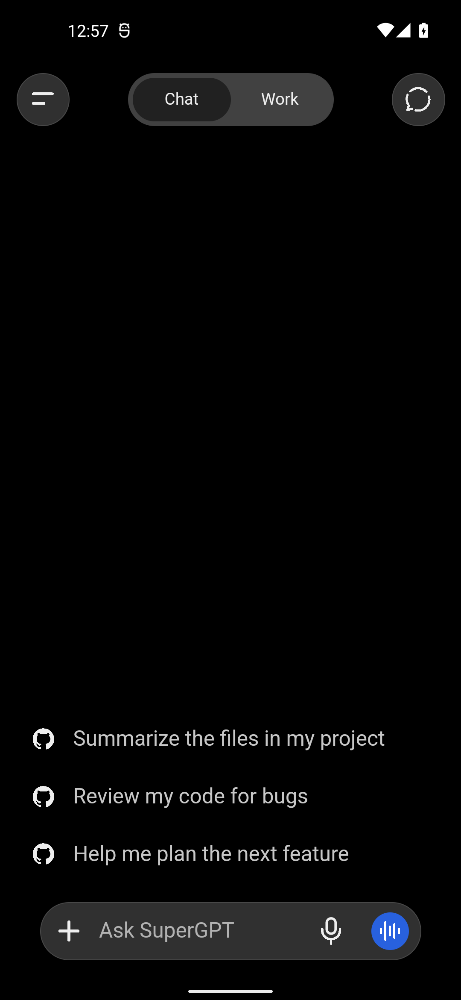

# Android release startup repair

Checkpoint: `ebf83d5`, before the runtime fix. The exact published v0.1.10 APK was reproduced crashing on Android API 32, with ARM64 translation. `am start -W` reported success even though the app process immediately exited.

## Root cause and files changed

The release Gradle configuration omitted `proguard-android-optimize.txt`. R8 removed the reflective `values()` entry point from Jackson's `SerializationFeature` enum. Tauri initializes Jackson in `PluginManager`, so startup failed before the WebView chat screen appeared. The observed exception was `ExceptionInInitializerError` caused by `NoSuchMethodException: C0.H.values []`; the v0.1.10 R8 mapping resolves `C0.H` to that enum.

- `src-tauri/gen/android/app/build.gradle.kts`: restore the default Android rules alongside existing project/JNI rules. R8 remains enabled.
- `scripts/androidStartupSmoke.mjs`, `tests/android-startup.test.mjs`, `package.json`: install and launch the actual release APK on an explicitly selected Android device, check process survival, foreground activity, rendered WebView UI and startup crashes, and record its SHA-256.
- `scripts/publishAndroidRelease.mjs`: reject publication without a successful runtime report for that exact APK hash.
- `AGENTS.md` and release documentation: require packaged startup validation, preserving the permanent certificate, production package and stable asset naming.
- App version metadata: patch version for the corrected APK; the broken v0.1.10 asset is not replaced.

Dependencies added: none. Endpoint transports, credentials, chat rendering and application feature code are unchanged by this repair.

## Verification

The new runtime check rejects the exact v0.1.10 APK with `The packaged app crashed during startup.` and records the original APK hash `b092824e865f9da4da3735470aefbbd4e16cbb01ee863a40b2ea3f2bcece9ef1`.

Final results for `SuperGPT.apk` v0.1.11, Android version code 1011:

- 212 automated application tests passed; zero failures. Production frontend build and emitted SDK stylesheet-order check passed.
- Rust release build completed with v0.1.11. Android release assembly, R8 and lint passed. The merged native input hash matches the final compiled library; ELF load segments and APK ZIP alignment passed 16 KB checks.
- Non-debuggable production package `id.sakelar.client`, ARM64, min SDK 24, target SDK 36. APK signatures verified against the unchanged pinned release certificate. Archive scan found no private signing/configuration files.
- Three cold starts of the exact final APK passed on API 32 with ARM64 translation: surviving process, foreground activity, real chat controls and no startup crashes. The local welcome name was configured on the emulator; no provider credentials were entered. Data was retained across replacement installs.
- Home then resume passed with the same app process and rendered chat UI. This checks short background/resume behavior, not long-running provider tasks.
- REA inspection of the final APK confirms `values()` and `valueOf(String)` are present in the affected enum. Final REA class evidence: `ev_f1fbd419d1c228824cbf032d86eeb35de78da78cb1cc7361d13f8446760323c0`.
- The initially attempted packaging helper used an unsupported Gradle configuration-cache setter. That temporary helper was removed; final assembly used the completed v0.1.11 Rust output and direct offline Gradle with `--no-configuration-cache`. No project build setting was changed for that workaround.

APK size: 22,708,816 bytes. SHA-256: `db6bb3bab973c446845a465e2c31f499726d1b4ed21237f8b3bc330bbe5581d2`.

Machine-readable, sanitized results: [android-startup-v0.1.11.json](android-startup-v0.1.11.json). Screenshot captured from the final APK after Home/resume:

## Remaining limitations

An Android emulator does not establish behavior on every Samsung device or Android/WebView version. No physical Samsung device is attached. Microphone, camera, haptics, provider credentials, MCP authentication and provider-specific responses are outside this startup regression test. Existing custom-endpoint compatibility constraints still apply.

The default platform rules are recommended by the [official Android keep-rules documentation](https://developer.android.com/topic/performance/app-optimization/keep-rules-overview); the particular crash above is established by the packaged APK, its mapping and Android crash logs.
