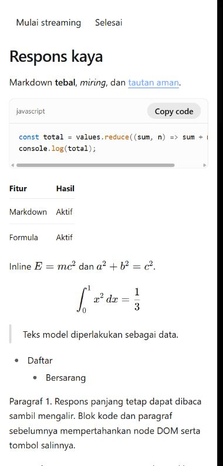
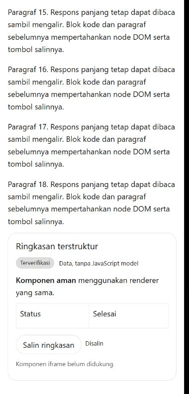
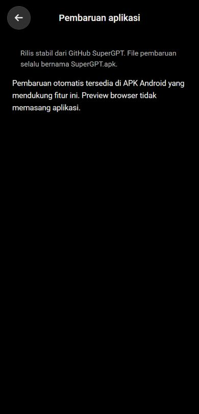

# Updates, streaming feedback and rich responses

Implementation checkpoint: `d767267`, before source changes. Baseline: `752a35d`.

## Files changed

- `src/components/RichText.tsx`, `RichTextRenderer.tsx`, `richMarkdown.ts`, `src/desktop/rich-text.css`: shared rich response rendering, loading fallback, Markdown block reconciliation and math.
- `src/agent/SafeWidget.tsx`, `safeWidgets.ts`, `agentItem.ts`, `AgentMessageExtras.tsx`, `agent-message.css`, `mainClient.ts`: structured data validation and bounded declarative rendering in the existing chat.
- `src/mobile/MobileStreamingReply.tsx`, `streamingText.ts`, `streamHaptics.ts`, `src/lib/useMobileConversation.ts`, `clientSettings.ts`: streaming presentation, successful-generation tracking, haptic preferences and throttled history persistence.
- `src/mobile/MobileUpdates.tsx`, `appUpdates.ts`, `updates.css`, `MobileSettings.tsx`, `MobileApp.tsx`: update settings, native bridge state and ready-to-install banner.
- `src-tauri/gen/android/app/src/main/java/id/sakelar/client/{ReleaseUpdater,ReleasePolicy,UpdateBridge,MainActivity,DeviceActionsBridge}.kt`, Android manifest and FileProvider paths: native update/download/install flow and haptics.
- `scripts/publishAndroidRelease.mjs`, `AGENTS.md`, `package.json`, lockfile and `vite.config.ts`: constant release asset naming, stable releases, explicit dependencies and separate math bundle.
- `tests/rich-responses-updates.test.cjs`, existing conversation/reasoning/agent-stream tests, Android `ReleasePolicyTest.kt`, and `tests/fixtures/rich-responses.{html,tsx}`: regression tests and reproducible browser fixture.

## Dependencies added

Direct, exact declarations: `unified@11.0.5`, `remark-parse@11.0.0`, `remark-gfm@4.0.1`, `remark-math@6.0.0`, `rehype-katex@7.0.1`, `katex@0.18.2`. These versions were already present transitively; npm reported no new packages and zero audit vulnerabilities at installation. Existing OpenAI Apps SDK UI remains the Markdown/code renderer. No updater dependency or new external update service was added.

## Features implemented

### Android updates

- Fixed source: stable `latest` release of `gabrieelibrahim/SuperGPT`; never drafts/prereleases or a configurable APK host. Checks on resume are throttled to six hours, with a persisted twelve-hour background job. Android controls actual job timing.
- Exact asset name `SuperGPT.apk`. Release metadata must supply SHA-256. Real DownloadManager downloads survive ordinary backgrounding; Wi-Fi-only downloads are the default.
- Before installation, verify byte length, SHA-256, matching package identity, higher Android version code, tag/version-name agreement and the installed signing certificate. Missing digests or different signing keys fail closed.
- Automatic installation is attempted on Android 12+ only with installation permission, while the app is in the background and no chat task is active. Android may still require user action. The UI then offers the system installer. Installation sessions are correlated, abandoned on failure and recovered after interruption.
- Settings allow automatic checking, downloading, installation attempts and Wi-Fi-only downloads to be controlled separately. Browser previews explicitly show that Android installation is unavailable.
- Future release command: `npm run release:android -- --tag vX.Y.Z --apk <built-apk> --notes <release-notes> --startup-report <report.json>`. It checks APK metadata/signature, prepares `SuperGPT.apk` and `SHA256SUMS.txt`, requires an existing tag, publishes with `--prerelease=false --latest`, and verifies the uploaded asset digest. Add `--dry-run` to verify/prepare without publication. Publication still requires user authorization.

### Streaming and haptics

- Short/medium responses produce one completion pulse after successful generation and after displayed text catches up. Failed/canceled requests and reopened history do not produce completion feedback.
- Responses reaching 3,000 displayed characters may produce subtle progress ticks, at least 900 ms and 240 new characters apart, followed by completion feedback. Progress and completion have separate native rate limits.
- `Pengaturan > Umum > Getaran streaming` controls feedback. Hidden pages stay quiet. Android respects system haptic settings; browser vibration is best effort.
- Long streaming text paints at approximately 20 updates/second, preserves surrogate pairs, coalesces chunks and flushes final content. Synchronous history writes are limited to four/second with mandatory initial/final writes.

### Rich responses

- GFM headings, lists, links, tables and code blocks use the shared renderer during and after streaming. Completed top-level blocks retain stable keys and memoized content; code copy state survives later streaming updates.
- TeX supports `$...$`, `$$...$$` and common `\(...\)`/`\[...\]` provider delimiters. Code AST ranges, including nested code, are preserved. Reference definitions keep document-wide Markdown semantics.
- KaTeX runs with untrusted commands disabled and bounded expansion/size. HTML is skipped, active URL schemes/embedded credentials are rejected, external images require an explicit click, and very large code blocks fall back to escaped plain code rather than expensive highlighting.
- Cold renderer loading shows a skeleton rather than flashing raw Markdown. The error boundary retains escaped text if formatting fails. Math and code/table overflow stay inside their components.
- Structured cards, rows/columns, text, Markdown, badges, dividers, lists and tables are validated with depth/node/text limits. Table structure is checked. Unknown types display a visible unsupported message. Only implemented copy and live tool-approval actions can run after a user click; arbitrary model HTML, JavaScript, styles and actions never execute.

## Tests performed

- `npm test`: **205 passed, 0 failed**. Includes provider/endpoint regressions, streaming cancellation/history, completion identity, stable block prefixes, nested code preservation, math safety, malicious/cyclic/oversized widget data, actual structured rendering and stable-release arguments.
- Renderer-dependent reasoning and agent-stream tests now wait for React's asynchronous renderer to finish; they no longer accidentally assert against the loading fallback.
- `npm run build`: TypeScript and production Vite build; the existing emitted SDK CSS order guard remains enabled.
- Android `:app:testArm64DebugUnitTest -x :app:rustBuildArm64Debug`: **4 native policy tests passed**, including stable version ordering, fixed asset URLs, digest/size validation and background-install eligibility. Kotlin sources compile as part of this task. No new APK was packaged.
- Running browser fixture at 390 px: Markdown/code/table, three rendered formulas, nested lists and safe widget card verified. Copy code stayed `Copied` through stream completion. Two tables, zero iframes, no page horizontal overflow.
- Fixture at 320 px: formulas/tables retained, no page horizontal overflow. Main settings checked at 390 px, including the haptic switch and updates page. Back from detail returned to settings, then chat. Temporary viewport override restored.
- Existing APK metadata and GitHub latest-release metadata were inspected to confirm package/version/digest formats. This is not an end-to-end installation test or a real private-provider request.

## Remaining limitations

- The first APK containing this updater must be installed manually. Older APKs cannot acquire new updater code on their own. Future releases must preserve package ID/signing key and increase version code.
- No connected Android device was available for an actual update download/install, process-death recovery, OEM background scheduling or physical haptic test. Native unit/compilation checks do not replace those device tests. Android 7–11 use installer confirmation; Android 12+ can still require it.
- Automatic installation is deliberately deferred while the app/chat is active. Revoked install permissions, system battery restrictions or GitHub/network availability can delay updates. GitHub API rate limits produce a visible retryable error.
- This change does not package, publish or rename an existing GitHub release. The release naming rule is enforced for future releases through the script and project instructions.
- Stable-block memoization and bounded paint/storage work reduce avoidable work; no physical-device performance benchmark or exact proprietary ChatGPT animation/haptic equivalence is claimed.

## Screenshots where possible

Captured from running components, using a development fixture rather than a live paid provider:

## Known provider compatibility issues

- Markdown is a presentation layer over the existing text transports. Existing supported custom Chat Completions/Responses endpoints and fallback paths remain intact; they do not need ChatKit metadata for Markdown, code, tables or math.
- Providers must emit valid Markdown/TeX to obtain the corresponding formatting. Incomplete syntax may change interpretation as it completes. Unsupported TeX commands show a readable error/fallback; ordinary dollar amounts can be ambiguous with single-dollar math syntax.
- Structured widgets require supported structured events. Plain text endpoints do not automatically become widget providers. Only the documented subset above is rendered; this is not the full ChatKit widget/runtime/action surface. Unsupported components are explicit, and unsupported buttons are disabled.
- Audio, vision, web search, MCP, billing and provider credentials retain their existing capabilities and configuration requirements. Rich rendering does not enable a provider-side tool or model it does not support. No new live calls were made with private provider credentials.
- HTML/JS execution, arbitrary provider CSS, arbitrary widget actions and automatic remote image loading are intentionally unsupported.

## Public references versus inferred UX

[Official OpenAI ChatKit widgets guide](https://developers.openai.com/api/docs/guides/chatkit-widgets) documents structured widgets and Markdown updates. It does not publish ChatGPT mobile animation timings, vibration thresholds or full private app behavior. The thresholds and transitions here are implementation choices informed by the supplied references.

[Official Android PackageInstaller requirements](https://developer.android.com/reference/android/content/pm/PackageInstaller.SessionParams#setRequireUserAction(int)) describe conditional updates without user action and the need to handle pending user action. Automatic installation is conditional, not a universal silent-update guarantee.
